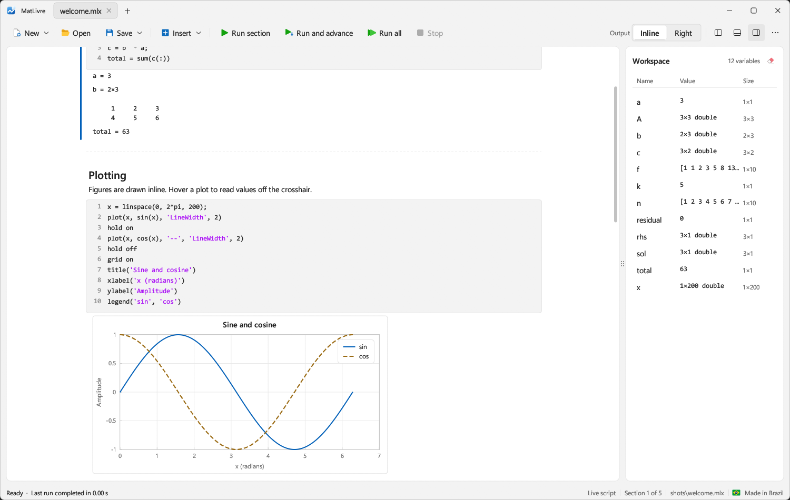
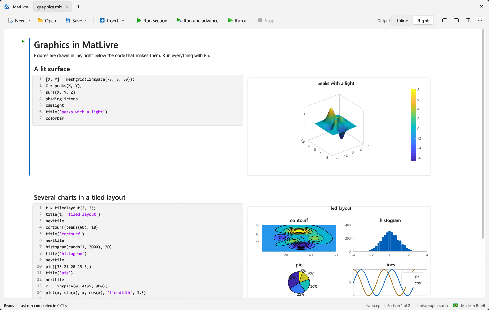

# MatLivre

<!-- release-manager:download -->
[](https://github.com/campuslivre/matlivre/releases/download/v0.1.0/matlivre-win-Setup.exe)

[matlivre-win-Setup.exe](https://github.com/campuslivre/matlivre/releases/download/v0.1.0/matlivre-win-Setup.exe) · Windows installer, version 0.1.0
<!-- /release-manager:download -->

**MatLivre is a fast live script editor and runtime for MATLAB code.** It opens, edits and runs
MATLAB live scripts (`.mlx`) and plain scripts (`.m`) with results, tables and figures inline,
in a native Windows 11 app. The language engine is an independent, clean-room implementation
of MATLAB, written in Rust: no MATLAB installation, license or Java runtime is needed.



- **Starts in a blink.** The app is ready in 0.3 s (1 s on a first launch). MATLAB needs
  about 4 s for its desktop to run code and 24 s on a cold first start.
- **Runs live scripts fast.** A typical notebook with four figures runs in 0.11 s. MATLAB's
  Live Editor takes 4.9 s for the same file, and 14.3 s the first time: 43 to 100 times slower.
- **Runs code fast.** On a 12-case benchmark of loops, recursion, array growth, linear
  algebra, sorting, strings, structs and cells, MatLivre is 4.7x faster than MATLAB R2023b and
  65x faster than GNU Octave (geometric mean), with identical results in all three.
- **Speaks MATLAB.** 1,039 MATLAB and Symbolic Math Toolbox functions, MATLAB's display format,
  error messages and semantics, checked against MATLAB R2023b output.
- **One small program.** A single 36 MB executable that depends only on DLLs shipped with
  Windows.

## Performance

All measurements on the same machine: Intel Core i5-10600K (6 cores / 12 threads), 24 GB RAM,
Windows 11 Pro. MATLAB R2023b Update 3, GNU Octave 11.3.0, MatLivre release build. Programs
were run one after another, never concurrently.

### Cold start

Time from launching the program until it has run a line of code. For the desktop apps this is
the time until you can work in them.

| Program | First launch | Warm launch |
|---|---:|---:|
| **MatLivre app** (window up, ready to run) | **0.97 s** | **0.31 s** |
| **MatLivre CLI** (runs a script) | **0.03 s** | **0.07 s** |
| GNU Octave CLI (`--eval`) | 2.56 s | 0.35 s |
| MATLAB desktop (runs a startup command) | — | 3.90 s |
| MATLAB `-batch` | 24.30 s | 6.84 s |

"First launch" is the first start in a session (MATLAB's was a true cold start: 24 s before
it ran anything); "warm launch" is the median of three more starts, with the program's files
already in the disk cache. MATLAB's desktop was measured after its batch runs, so only its warm
time is shown. The Octave GUI is not in the table: its first start stops at a setup wizard.
Script: [`benchmarks/coldstart.ps1`](benchmarks/coldstart.ps1).

### Live scripts

[`benchmarks/livescript/bench_live.mlx`](benchmarks/livescript/bench_live.mlx) is a typical
analysis notebook: eight sections with matrix algebra, a loop, statistics, a table, string
processing and four figures (a line plot, a surface with a colorbar, a histogram and a 2x2
grid of subplots). The time covers running every section, capturing the outputs and drawing
the figures.

| Engine | First run | Warm run |
|---|---:|---:|
| **MatLivre** | **0.14 s** | **0.11 s** |
| MATLAB Live Editor (`executeAndSave`) | 14.30 s | 4.91 s |
| MATLAB, same code as a plain `.m` script | 1.17 s | 0.37 s |
| GNU Octave | cannot run live scripts | |

MatLivre is about **43x faster** than MATLAB's Live Editor on a warm run and **100x faster** on
the first run in a session. MATLAB runs the same code as a plain script in 0.37 s, so most of
its live script time is the Live Editor itself: evaluating section by section, capturing each
output and figure, and writing them into the file. MatLivre's time covers loading the `.mlx`,
running every section, capturing the outputs and rendering the four figures (it does not write
outputs back into the file). Warm runs are the best of three in an already running program.
Scripts: [`benchmarks/livescript`](benchmarks/livescript).

**Does Octave run live scripts?** No. GNU Octave has no live script support: it cannot open or
run `.mlx` files, and it has no live editor with inline output. The closest it offers is `%%`
code sections in plain `.m` files in its editor, with output going to the command window and
figures to separate windows.

### Language and numerics

[`benchmarks/bench.m`](benchmarks/bench.m) runs unchanged in all three engines; each case is
the best of 3 runs and reports a checksum, and **all 12 checksums agree**.

| Case | MATLAB (ms) | Octave (ms) | MatLivre (ms) | MatLivre vs MATLAB |
|---|---:|---:|---:|---|
| scalar_loop (2M iterations) | 4.92 | 2,265.87 | 2.62 | 1.9x faster |
| while_branch (Collatz, 2.9M steps) | 102.22 | 11,742.56 | 13.86 | 7.4x faster |
| fib_recursive (fib(20)) | 0.66 | 128.88 | 0.06 | 11.3x faster |
| array_growth (100k appends) | 8.43 | 402.17 | 1.42 | 5.9x faster |
| indexed_assign (1M writes) | 4.01 | 2,115.03 | 3.15 | 1.3x faster |
| vector_math (2M elements) | 121.78 | 127.25 | 86.36 | 1.4x faster |
| matmul_300 | 1.81 | 0.51 | 0.41 | 4.5x faster |
| linsolve_300 | 0.61 | 1.85 | 0.73 | 1.2x slower |
| sort_1e6 | 58.93 | 17.77 | 9.36 | 6.3x faster |
| string_build (20k appends) | 201.63 | 264.22 | 29.53 | 6.8x faster |
| struct_fields (500k updates) | 170.42 | 4,568.02 | 0.68 | 252x faster |
| cell_ops (100k writes + reads) | 31.25 | 581.45 | 17.70 | 1.8x faster |

Geometric mean: **4.7x faster than MATLAB, 64.8x faster than Octave**. Details and the
per-case Octave comparison are in [`benchmarks/RESULTS.md`](benchmarks/RESULTS.md).

### Why it is fast

- **Native code for loops and functions.** `for`/`while` loops and user functions over scalars,
  array elements, cell elements and struct fields are compiled to machine code with Cranelift.
  Everything else is interpreted, with identical behavior (differential tests run every case
  both ways).
- **Multithreaded linear algebra** through `faer`: blocked matrix products and LU
  factorization.
- **Parallel elementwise math and sorting** on large arrays (rayon).
- **No copies where MATLAB semantics allow it**: in-place appends (`x(end+1) = v`,
  `s = [s v]`), in-place element writes, operands read by reference.
- **A small runtime**: no JVM, no desktop framework to boot; the app is one native process.

## The app



- Live scripts with formatted text, code, and results inline or on the right; run a section
  (Ctrl+Enter), run and advance (Ctrl+Shift+Enter) or run all (F5), and stop between
  statements.
- Live controls (sliders, drop-downs, check boxes, edit fields) in `.mlx` files.
- Figures drawn inline: 2-D and 3-D plots, surfaces with lighting, contours, images, bar, pie,
  histogram and more, tiled layouts, annotations and colorbars, with a crosshair
  that reads values off the plot. `saveas`, `print` and `exportgraphics` write PNG and SVG.
- A files panel, workspace browser, command window and floating figure windows; tabs that can
  be dragged between windows; light and dark themes.
- Code runs on its own engine thread, so the editor never freezes while a script runs.

| Shortcut | Action |
|---|---|
| Ctrl+Enter | Run current section |
| Ctrl+Shift+Enter | Run section and advance |
| F5 | Run all |
| Ctrl+Alt+Enter | Insert section break |
| Ctrl+N / Ctrl+O / Ctrl+S | New / Open / Save |

## The language

MATLAB compatibility is the rule: semantics, display and error messages follow MATLAB R2023b.
[`docs/matlab-coverage.md`](docs/matlab-coverage.md) lists every function of the MATLAB and
Symbolic Math Toolbox references and its status (1,039 implemented).

- N-D arrays of every numeric type, `logical`, `char` and strings, with implicit expansion,
  saturating integer arithmetic and complex numbers.
- Cell arrays, struct arrays, function handles and anonymous functions, `containers.Map`,
  `dictionary`, `categorical`, `table` (joins, grouping, reshaping), `datetime`, `duration`
  and `calendarDuration`.
- `classdef` classes (properties, methods, static methods, inheritance, handle and value
  semantics, operator overloading) and function files from the script's folder.
- Mathematics: linear algebra and factorizations, polynomials and interpolation, ODE solvers,
  integration, minimization and root finding, statistics, FFT and filtering, computational geometry, special
  functions.
- Symbolic Math: exact arithmetic, `diff`, `int`, `limit`, `taylor`, `series`, `solve`,
  `vpasolve`, Laplace transforms, `simplify`, `partfrac`, symbolic matrices and
  number theory.
- Files: text and CSV I/O, `readtable`/`writetable`, MAT files, images and audio, JSON and XML,
  zip and tar archives.

Try [`examples/welcome.m`](examples/welcome.m), [`examples/graphics.m`](examples/graphics.m) and
[`examples/features.m`](examples/features.m).

## Build from source

```bash
cargo run -p livre-app --release
```

Pass a file to open it: `cargo run -p livre-app --release -- path\to\script.mlx`. On Windows,
`build.bat` builds and `run.bat [file]` builds and starts the app. `target\release\matlivre.exe`
links the C runtime statically (`.cargo/config.toml`), so it runs on any Windows 10/11 machine
without installing anything.

`matlivre-cli script.m` runs a script headless and prints its output.

## Project layout

| Crate | Purpose |
|---|---|
| `crates/livre-lang` | Lexer, parser, interpreter and native-code compiler, values and MATLAB display, builtins, classdef, Symbolic Math, figure model |
| `crates/livre-doc` | Live script document model; `.mlx` (OPC/ZIP + WordprocessingML) and `.m` reader/writer |
| `crates/livre-app` | The desktop app (eframe/egui): editor, outputs, plots, workspace, command window |

## Clean-room process

MatLivre was written from observed behavior only. The live script format is described in
[`docs/SPEC-live-script.md`](docs/SPEC-live-script.md), produced by inspecting the `.mlx` data
files shipped with MATLAB and the public behavior of the Live Editor. Language behavior is
checked by running code in MATLAB and comparing outputs. No MathWorks source code was read or
copied.

## Tests

```bash
cargo test --workspace
```

The tests compare MatLivre's output with MATLAB R2023b's for each function family.
`livre-doc/tests/matlab_samples.rs` round-trips the live scripts shipped with a local MATLAB
installation when one is present. Benchmarks: [`benchmarks/run_bench.bat`](benchmarks/run_bench.bat)
(language), [`benchmarks/coldstart.ps1`](benchmarks/coldstart.ps1) (start-up) and
[`benchmarks/livescript`](benchmarks/livescript) (live scripts).

## Known limits

- Saved outputs in `.mlx` files are not restored when opening (run the script to regenerate
  them) and are not written back.
- Rich text in live scripts (bold and italic runs, links, equations, images) is shown as plain
  text.
- Functions still to implement are listed in [`docs/matlab-coverage.md`](docs/matlab-coverage.md),
  among them timetables, sparse matrices, graph algorithms and polar axes.
- Windows is the only tested platform.

## License

[MIT](LICENSE)
