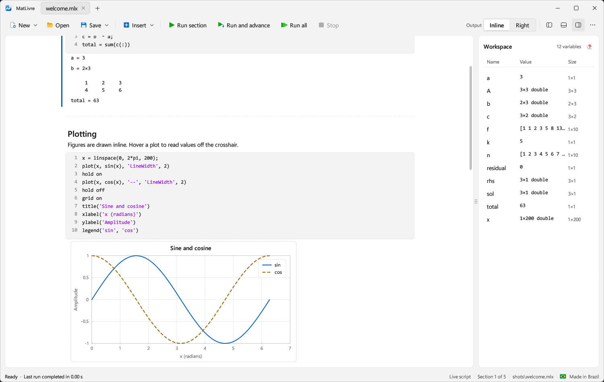
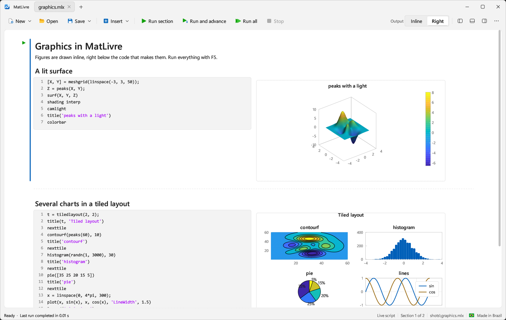

# MatLivre

<!-- release-manager:download -->
[](https://github.com/campuslivre/matlivre/releases/download/v0.1.4/matlivre-win-Setup.exe)

[matlivre-win-Setup.exe](https://github.com/campuslivre/matlivre/releases/download/v0.1.4/matlivre-win-Setup.exe) · Windows installer, version 0.1.4
<!-- /release-manager:download -->

**MatLivre is a fast live script editor and runtime for MATLAB code.** It opens, edits and runs
MATLAB live scripts (`.mlx`) and plain scripts (`.m`) with results, tables and figures inline,
in a native Windows 11 app. The language engine is an independent, clean-room implementation
of MATLAB, written in Rust: no MATLAB installation, license or Java runtime is needed.



- **Starts in a blink.** The app is ready in 0.3 s (1 s on a first launch). MATLAB needs
  about 4 s for its desktop to run code and 24 s on a cold first start.
- **Runs live scripts fast.** A typical notebook with four figures runs in 0.11 s. MATLAB's
  Live Editor takes 4.9 s for the same file, and 14.3 s the first time: 43 to 100 times slower.
- **Runs code fast.** On a 12-case benchmark of loops, recursion, array growth, linear
  algebra, sorting, strings, structs and cells, MatLivre is 5.5x faster than MATLAB R2023b,
  83x faster than GNU Octave and 83x faster than Scilab (geometric mean), with identical results
  in all four.
- **Speaks MATLAB.** 1,879 MATLAB and Symbolic Math Toolbox functions, MATLAB's display format,
  error messages and semantics, checked against MATLAB R2023b output.
- **One small program.** A single 36 MB executable that depends only on DLLs shipped with
  Windows.

## Performance

All measurements on the same machine: Intel Core i5-10600K (6 cores / 12 threads), 24 GB RAM,
Windows 11 Pro. MATLAB R2023b Update 3, GNU Octave 11.3.0, Scilab 2025.0.0, MatLivre release build. Programs
were run one after another, never concurrently.

### Cold start

Time from launching the program until it has run a line of code. For the desktop apps this is
the time until you can work in them.

| Program | First launch | Warm launch |
|---|---:|---:|
| **MatLivre app** (window up, ready to run) | **0.97 s** | **0.31 s** |
| **MatLivre CLI** (runs a script) | **0.03 s** | **0.07 s** |
| GNU Octave CLI (`--eval`) | 2.56 s | 0.35 s |
| MATLAB desktop (runs a startup command) | — | 3.90 s |
| MATLAB `-batch` | 24.30 s | 6.84 s |

"First launch" is the first start in a session (MATLAB's was a true cold start: 24 s before
it ran anything); "warm launch" is the median of three more starts, with the program's files
already in the disk cache. MATLAB's desktop was measured after its batch runs, so only its warm
time is shown. The Octave GUI is not in the table: its first start stops at a setup wizard.
Script: [`benchmarks/coldstart.ps1`](benchmarks/coldstart.ps1).

### Live scripts

[`benchmarks/livescript/bench_live.mlx`](benchmarks/livescript/bench_live.mlx) is a typical
analysis notebook: eight sections with matrix algebra, a loop, statistics, a table, string
processing and four figures (a line plot, a surface with a colorbar, a histogram and a 2x2
grid of subplots). The time covers running every section, capturing the outputs and drawing
the figures.

| Engine | First run | Warm run |
|---|---:|---:|
| **MatLivre** | **0.14 s** | **0.11 s** |
| MATLAB Live Editor (`executeAndSave`) | 14.30 s | 4.91 s |
| MATLAB, same code as a plain `.m` script | 1.17 s | 0.37 s |
| GNU Octave | cannot run live scripts | |

MatLivre is about **43x faster** than MATLAB's Live Editor on a warm run and **100x faster** on
the first run in a session. MATLAB runs the same code as a plain script in 0.37 s, so most of
its live script time is the Live Editor itself: evaluating section by section, capturing each
output and figure, and writing them into the file. MatLivre's time covers loading the `.mlx`,
running every section, capturing the outputs and rendering the four figures (it does not write
outputs back into the file). Warm runs are the best of three in an already running program.
Scripts: [`benchmarks/livescript`](benchmarks/livescript).

**Does Octave run live scripts?** No. GNU Octave has no live script support: it cannot open or
run `.mlx` files, and it has no live editor with inline output. The closest it offers is `%%`
code sections in plain `.m` files in its editor, with output going to the command window and
figures to separate windows.

### Language and numerics

[`benchmarks/bench.m`](benchmarks/bench.m) runs unchanged in MATLAB, Octave and MatLivre; Scilab
runs a line-by-line port, [`benchmarks/bench.sce`](benchmarks/bench.sce) (Scilab's syntax differs).
Each case is the best of 3 runs and reports a checksum, and **all 12 checksums agree in all four
engines**. Run date: 2026-11-07 (MatLivre column re-measured after the allocator change).

| Case | MATLAB (ms) | Octave (ms) | Scilab (ms) | MatLivre (ms) | MatLivre vs MATLAB | vs Scilab |
|---|---:|---:|---:|---:|---|---|
| scalar_loop (2M iterations) | 4.57 | 2,267.82 | 1,662.67 | 2.69 | 1.7x faster | 619x faster |
| while_branch (Collatz, 2.9M steps) | 79.62 | 11,231.69 | 70,510.38 | 14.30 | 5.6x faster | 4,929x faster |
| fib_recursive (fib(20)) | 0.96 | 123.42 | 70.68 | 0.06 | 15.8x faster | 1,159x faster |
| array_growth (100k appends) | 6.83 | 377.48 | 211.68 | 1.18 | 5.8x faster | 179x faster |
| indexed_assign (1M writes) | 2.93 | 1,996.90 | 879.51 | 2.36 | 1.2x faster | 373x faster |
| vector_math (2M elements) | 107.40 | 92.81 | 180.59 | 10.65 | 10.1x faster | 17.0x faster |
| matmul_300 | 0.68 | 0.55 | 0.19 | 0.33 | 2.1x faster | 1.8x slower |
| linsolve_300 | 0.53 | 1.54 | 0.48 | 0.59 | 1.1x slower | 1.2x slower |
| sort_1e6 | 59.09 | 14.82 | 185.38 | 6.97 | 8.5x faster | 26.6x faster |
| string_build (20k appends) | 207.04 | 249.86 | 491.80 | 35.30 | 5.9x faster | 13.9x faster |
| struct_fields (500k updates) | 144.11 | 4,309.09 | 1,841.38 | 0.65 | 223x faster | 2,846x faster |
| cell_ops (100k writes + reads) | 21.54 | 561.40 | 349.36 | 6.70 | 3.2x faster | 52.1x faster |

Geometric mean: **5.5x faster than MATLAB, 83x faster than Octave, 83x faster than Scilab**.
MatLivre is faster than MATLAB in 11 of 12 cases, than Octave in all 12 and than Scilab in 10.
Where it is behind: `linsolve_300` (MATLAB by 13%, Scilab by 25%) and `matmul_300` (Scilab, which
uses Intel MKL, by 1.7x). Cases under 1 ms vary by tens of percent
between runs. The suite is small and favours MatLivre's native loop compilation; it does not
measure toolbox breadth or plotting. Details and the per-case Octave comparison are in
[`benchmarks/RESULTS.md`](benchmarks/RESULTS.md).

### Sparse matrices and large vectorized operations

[`benchmarks/bench_sparse.m`](benchmarks/bench_sparse.m) runs in MATLAB R2023b and MatLivre, and
[`bench_sparse.sce`](benchmarks/bench_sparse.sce) is its Scilab version (best of 3, checksums
agree; Scilab has no `spdiags`, implicit expansion or `pcg`, so those parts are written out). This
is where MatLivre is behind: sparse matrices are stored densely, so sparse operations cost
O(n^2) instead of O(nonzeros), and sizes are limited by memory (MATLAB solves a 1,000,000-unknown
tridiagonal system in 23 ms; MatLivre cannot hold it). On large dense arrays it is ahead.

| Case | MATLAB (ms) | Scilab (ms) | MatLivre (ms) | vs MATLAB | vs Scilab |
|---|---:|---:|---:|---|---|
| sparse tridiagonal solve, n = 3,000 | 0.07 | 0.32 | 0.44 | 6.0x slower | 1.4x slower |
| 2-D Poisson solve, 2,500 unknowns | 1.69 | 87.5 | 6.66 | 3.9x slower | 13.1x faster |
| 200 sparse matrix-vector products, n = 3,000 | 2.10 | 6.99 | 13.1 | 6.2x slower | 1.9x slower |
| 20 builds with `sparse(i,j,s,n,n)`, n = 2,000 | 2.57 | 3.10 | 30.6 | 11.9x slower | 9.8x slower |
| conjugate gradients on the Poisson matrix | 3.02 | 2.87 | 3.96 | 1.3x slower | 1.4x slower |
| elementwise math, 1e7 elements | 139.8 | 485.2 | 31.9 | 4.4x faster | 15.2x faster |
| `cumsum`, 1e7 elements | 45.6 | 59.3 | 37.4 | 1.2x faster | 1.6x faster |
| `find` on a logical mask, 1e7 | 25.4 | 183.6 | 61.3 | 2.4x slower | 3.0x faster |
| broadcast arithmetic, 2000 x 2000 | 10.2 | 41.2 | 32.5 | 3.2x slower | 1.3x faster |
| row and column reductions, 2000 x 2000 | 8.18 | 102.6 | 8.19 | about equal | 12.5x faster |
| `sort`, 4e6 elements | 66.7 | 334.2 | 35.3 | 1.9x faster | 9.5x faster |
| `M*M`, 2000 x 2000 | 126.2 | 78.5 | 59.2 | 2.1x faster | 1.3x faster |

Square sparse systems of order 100 and up are solved with a sparse LU (Markowitz pivoting, taken
from the SolverLivre project) with a residual check and a fallback to the dense solver, and the
iterative solvers and the sparse products (`A*x`, `x'*A`) multiply with compressed columns,
which are built once per matrix and kept until it changes. Chains of elementwise operators on large
arrays (`exp(-x.^2) .* sin(20*x) + sqrt(x+1)`) are evaluated fused, in cache-sized blocks on
several threads, so only the result is written to memory; reductions, `cumsum`, `find`, `max`,
`min` and implicit expansion work on the arrays in place and in parallel when they are large.

### Other common operations

[`benchmarks/bench_more.m`](benchmarks/bench_more.m) times 34 everyday operations (linear algebra
factorizations, FFT, convolution, lookups, sorting, strings, function handles, structs and maps)
in MATLAB R2023b and MatLivre, best of 3, checksums recorded. MatLivre is faster in 9 of them,
within 4.6x of MATLAB in all of them, and 1.21x slower on the geometric mean; a selection:

| Case | MATLAB (ms) | MatLivre (ms) | MatLivre vs MATLAB |
|---|---:|---:|---|
| `expm`, 150 x 150 | 3.44 | 15.77 | 4.6x slower |
| `rand(1,1e7)` and `randn(1000)` | 67.51 | 253.1 | 3.7x slower |
| `fft`, 2^20 points | 6.62 | 24.00 | 3.6x slower |
| `chol`, 300 x 300 | 0.24 | 0.76 | 3.1x slower |
| `[Q,R] = qr`, 300 x 300 | 1.45 | 4.17 | 2.9x slower |
| `svd`, 300 x 300 | 5.55 | 13.80 | 2.5x slower |
| `[L,U,P] = lu`, 300 x 300 | 0.62 | 1.34 | 2.2x slower |
| `eig`, symmetric 300 x 300 | 2.45 | 4.56 | 1.9x slower |
| `inv`, 300 x 300 | 2.17 | 1.88 | 1.2x faster |
| `unique`, 1e6 elements | 48.56 | 46.04 | 1.1x faster |
| `ismember`, 1e5 in 1e5 | 3.38 | 4.37 | 1.3x slower |
| `[s,i] = sort`, 1e6 | 35.37 | 53.76 | 1.5x slower |
| `mean`, `std`, `median`, `var`, 1e6 | 14.07 | 11.03 | 1.3x faster |
| `cellfun` with an anonymous function, 1e5 | 161.5 | 47.04 | 3.4x faster |
| `num2str` in a loop, 1e4 | 147.0 | 19.52 | 7.5x faster |
| `containers.Map`, 5,000 inserts and lookups | 71.77 | 8.13 | 8.8x faster |
| 20,000 calls of a user function | 0.64 | 0.08 | 8.2x faster |
| `strjoin` and `strsplit`, 2e4 words | 14.27 | 3.51 | 4.1x faster |

### Why it is fast

- **Native code for loops and functions.** `for`/`while` loops and user functions over scalars,
  array elements, cell elements and struct fields are compiled to machine code with Cranelift.
  Everything else is interpreted, with identical behavior (differential tests run every case
  both ways).
- **Multithreaded linear algebra** through `faer`: blocked matrix products and LU
  factorization.
- **Parallel elementwise math and sorting** on large arrays (rayon).
- **A retaining allocator** (mimalloc): large arrays are not handed back to the OS and faulted in again
  on the next operation, which made products, solves and whole-array operations 25 to 35% faster.
- **No copies where MATLAB semantics allow it**: in-place appends (`x(end+1) = v`,
  `s = [s v]`), in-place element writes, operands read by reference.
- **A small runtime**: no JVM, no desktop framework to boot; the app is one native process.

## The app



- Live scripts with formatted text, code, and results inline or on the right; run a section
  (Ctrl+Enter), run and advance (Ctrl+Shift+Enter) or run all (F5), and stop between
  statements.
- Live controls (sliders, drop-downs, check boxes, edit fields) in `.mlx` files.
- Figures drawn inline: 2-D and 3-D plots, surfaces with lighting, contours, images, bar, pie,
  histogram, polar plots and more; charts (heatmaps, box, swarm and bubble charts, pie and
  donut charts, word clouds, stacked and parallel coordinates plots); two y axes (`yyaxis`, `plotyy`),
  secondary axis labels, date ticks, tiled layouts, annotations, data tips and colorbars, with a crosshair that reads values off
  the plot. Graphics objects are handles (`get`, `set`, `findobj`, `copyobj`, arrays of them). `saveas`, `print` and `exportgraphics` write PNG and SVG; `savefig` and `openfig` save and reopen MATLAB `.fig` files.
- A files panel (open a folder as the project root, like VS Code), workspace browser, command window and floating figure windows; tabs that can
  be dragged between windows; light and dark themes.
- Code runs on its own engine thread, so the editor never freezes while a script runs.
- Files changed by another program (an editor, Claude Code, git) reload in their tab, as in
  VS Code and MATLAB. A tab with unsaved changes asks instead: reload the file or keep your
  version, and it never saves over a change it has not shown you.
- Claude, through the Claude Code installed on your computer (no API key):
  - **Claude panel** (Ctrl+L): chat with Claude, which can run code in your workspace, see
    your figures, and read and edit the open documents. It asks before it runs or changes
    anything.
  - **Code completions**: after a pause in typing, Claude suggests the rest of the line or
    block in grey; Tab inserts it, Esc dismisses it, Alt+\ asks at once. Toggle them in the
    … menu.
  - **MCP server**: … › Connect Claude Code copies a `claude mcp add` command, after which
    Claude Code in a terminal works in the open MatLivre window (or in a MatLivre without a
    window, `matlivre --mcp`, when none is open).

| Shortcut | Action |
|---|---|
| Ctrl+Enter | Run current section |
| Ctrl+Shift+Enter | Run section and advance |
| F5 | Run all |
| Ctrl+Alt+Enter | Insert section break |
| Ctrl+N / Ctrl+O / Ctrl+S | New / Open / Save |
| Ctrl+L | Show or hide the Claude panel |
| Tab / Esc / Alt+\ | Accept / dismiss / request a code suggestion |

## The language

MATLAB compatibility is the rule: semantics, display and error messages follow MATLAB R2023b.
[`docs/matlab-coverage.md`](docs/matlab-coverage.md) lists every function of the MATLAB and
Symbolic Math Toolbox references and its status (1,879 implemented).

- N-D arrays of every numeric type, `logical`, `char` and strings, with implicit expansion,
  saturating integer arithmetic and complex numbers, shown in every `format` mode (`long g`, `bank`,
  `rat`, `hex`, ...); regular expressions and text patterns
  (`digitsPattern + "-" + lettersPattern`).
- Cell arrays, struct arrays, function handles, anonymous and `inline` functions, `memoize`, `containers.Map`,
  `dictionary`, `categorical`, `table` (joins, grouping, reshaping, `rowfilter`), `timetable`
  (`retime`, `synchronize`, `timerange`), `timeseries` and `tscollection`, `datetime` (with IANA time
  zones and daylight saving time), `duration` and `calendarDuration`.
- `classdef` classes (properties, methods, static methods, inheritance, handle and value
  semantics, operator overloading, events and listeners, dynamic properties, enumerations, System objects with
  `step`, `setup` and `release`) and function files from the script's folder; argument
  validation (`arguments` blocks with sizes, classes, validators, defaults and name-value
  options, `mustBe*`, `inputParser`), `Name=Value` arguments, error identifiers and `message` objects;
  `timer` objects, `diary`, `localfunctions` and the `settings` API.
- Graphs and networks: `graph` and `digraph` with shortest paths, search, components,
  spanning trees, topological sort, maximum flow, centrality, and plotting as a GraphPlot (`highlight`, `labelnode`, `labeledge`, `layout`).
- Sparse matrices: `sparse`, `spdiags`, `speye`, iterative solvers (`pcg`, `gmres`,
  `bicgstab`, `minres`, `lsqr`, ...), `ichol`, `ilu`, reorderings and `spy`.
- Mathematics: linear algebra and factorizations (with `decomposition` objects), polynomials and interpolation, ODE solvers
  (nonstiff, stiff, DAEs with mass matrices, fully implicit, output functions, also through `ode` objects), delay and boundary value problems,
  parabolic PDEs (`pdepe`), integration, minimization and root finding (with output and plot functions such as `optimplotfval`), statistics, FFT and filtering, computational geometry
  (polyshape booleans and buffers, triangulations, STL files), special
  functions, image resizing and indexed color (`imresize`, `rgb2ind`, `cmunique`).
- Symbolic Math: exact arithmetic, `diff`, `int`, `limit`, `taylor`, `series`, `solve`,
  `vpasolve`, Laplace, Z, Fourier and Hilbert transforms, `simplify`, `partfrac`, symbolic
  matrices with Jordan, Smith and Hermite forms, Groebner bases, `piecewise`, abstract
  functions (`syms y(t)`) with `dsolve` for linear differential equations, DAE structure tools
  (`massMatrixForm`, `isLowIndexDAE`, `findDecoupledBlocks`, `odeFunction`), `combine`,
  `root`, `eliminate`, MathML output, `sympref`, number theory,
  special functions (elliptic integrals and Jacobi elliptic functions, exponential,
  trigonometric and Fresnel integrals, polylogarithms, hypergeometric functions), the
  classical orthogonal polynomials, polynomial division and reduction, resultants, Pade
  approximants, scalar and vector potentials, numeric sums and integrals (`vpasum`,
  `vpaintegral`), the symType queries (`symType`, `findSymType`, `mapSymType`) and units of
  measurement (`symunit`, `unitConvert`, `checkUnits`, `newUnit`).
- Files: text and CSV I/O, Excel workbooks (`readtable`, `xlsread`, `writetable`), MAT files, images (with `imtile` and the `imformats` registry) and audio, the `Tiff` class (tags, strips, tiles, LZW and Deflate), JSON and XML,
  zip and tar archives.

Try [`examples/welcome.m`](examples/welcome.m), [`examples/graphics.m`](examples/graphics.m) and
[`examples/features.m`](examples/features.m).

## Build from source

```bash
cargo run -p livre-app --release
```

Pass a file to open it: `cargo run -p livre-app --release -- path\to\script.mlx`. On Windows,
`build.bat` builds and `run.bat [file]` builds and starts the app. `target\release\matlivre.exe`
links the C runtime statically (`.cargo/config.toml`), so it runs on any Windows 10/11 machine
without installing anything.

`matlivre-cli script.m` runs a script headless and prints its output.

### Linux

Install the build dependencies (Ubuntu/Debian) and Rust (via rustup), then build:

```bash
sudo apt install build-essential pkg-config libgtk-3-dev libxkbcommon-dev libwayland-dev
cargo run -p livre-app --release
```

`tools/linux/package.sh` builds and packs `dist/matlivre-linux-<arch>.tar.gz`; its
`install.sh` installs `matlivre` and `matlivre-cli` into `~/.local/bin` and adds MatLivre to
the application menu.

## Project layout

| Crate | Purpose |
|---|---|
| `crates/livre-lang` | Lexer, parser, interpreter and native-code compiler, values and MATLAB display, builtins, classdef, Symbolic Math, figure model |
| `crates/livre-doc` | Live script document model; `.mlx` (OPC/ZIP + WordprocessingML) and `.m` reader/writer |
| `crates/livre-app` | The desktop app (eframe/egui): editor, outputs, plots, workspace, command window |

## Clean-room process

MatLivre was written from observed behavior only. The live script format is described in
[`docs/SPEC-live-script.md`](docs/SPEC-live-script.md), produced by inspecting the `.mlx` data
files shipped with MATLAB and the public behavior of the Live Editor. Language behavior is
checked by running code in MATLAB and comparing outputs. No MathWorks source code was read or
copied.

## Tests

```bash
cargo test --workspace
```

The tests compare MatLivre's output with MATLAB R2023b's for each function family.
`livre-doc/tests/matlab_samples.rs` round-trips the live scripts shipped with a local MATLAB
installation when one is present. Benchmarks: [`benchmarks/run_bench.bat`](benchmarks/run_bench.bat)
(language), [`benchmarks/coldstart.ps1`](benchmarks/coldstart.ps1) (start-up) and
[`benchmarks/livescript`](benchmarks/livescript) (live scripts).

## Known limits

- Saved outputs in `.mlx` files are not restored when opening (run the script to regenerate
  them) and are not written back.
- Rich text in live scripts (bold and italic runs, links, equations, images) is shown as plain
  text.
- Functions still to implement are listed in [`docs/matlab-coverage.md`](docs/matlab-coverage.md),
  among them DAE index reduction (`reduceDAEIndex`, `reduceDAEToODE`), symbolic code generation (`ccode`,
  `fortran`), `subexpr`, and spreadsheet and XML import options.
- The Symbolic Math special functions evaluate to double precision only: `vpa` keeps
  `sinint(2)` and the like in symbolic form (`catalan` and `eulergamma` evaluate). Some
  complex-valued cases (`logint` and `igamma` of negative numbers, `ellipticPi` with `n > 1`)
  give `NaN`, and polynomials with symbolic parameters (`gegenbauerC(3, a, x)`) are equal to
  MATLAB's but grouped differently. `poles` finds the poles of rational functions only
  (not those of `tan(x)`).
- Symbolic units cover about 100 common units with the SI prefixes, out of MATLAB's larger
  list; conversion to a unit system supports SI only, `unitInfo` lists only the units
  MatLivre knows, and `simplify` does not combine terms with different units of the same
  dimension (`2*[m] + 300*[cm]`).
- The Z, Fourier and Hilbert transforms cover the common transform pairs (polynomials and
  exponentials, sines and cosines, Gaussians, Dirac and Heaviside functions); other inputs
  stay unevaluated where MATLAB finds a closed form. `iztrans` needs rational poles, and
  `smithForm` and `hermiteForm` work on integer matrices only.
- `dsolve` solves single linear equations (constant coefficients, or first order with
  variable coefficients) with initial conditions; systems and nonlinear equations are not
  solved, and the order of terms in some solutions differs from MATLAB's
  (`C1*exp(-t) + exp(t)/2`).
- Table custom properties (`addprop`) are kept and read back, but `T.Properties` shows as a
  struct rather than MATLAB's `TableProperties` object.
- `histcounts` with only a number of bins places its rounded edges by a simpler rule than
  MATLAB's, so the edges (and counts) can differ; given edges, widths, limits or the
  automatic method, they match.
- `Tiff` reads and writes uncompressed, PackBits, LZW and Deflate data without a predictor;
  JPEG-compressed and BigTIFF files are not read, and mode `'w8'` writes a classic TIFF.
- `combine` handles the `powers`, `exp`, `log` (with `IgnoreAnalyticConstraints`) and
  `sincos` targets. `sympref` keeps every preference, but of them only `HeavisideAtOrigin`
  changes results.
- Chart layouts that MATLAB fits to the screen (word clouds, bubble clouds, automatic
  `binscatter` bins) are approximated, `geobubble` draws no basemap, and graph plots place nodes like MATLAB only for the `'circle'` layout and simple `'layered'` ones (force layouts differ).
- Dithering in `rgb2ind` and `dither` is plain Floyd-Steinberg, so individual pixels can
  differ from MATLAB's; `'nodither'` matches.
- Random numbers come from MATLAB's Mersenne Twister, so `rand`, `randi` and `randperm` give
  MATLAB's values for a seed, but `randn` with the default Ziggurat transform does not (the
  `Polar` and `Inversion` transforms of `RandStream` do), and `randperm(n, k)` differs when `k`
  is more than a fifth of `n`.
- `timer` callbacks run during `pause`, `wait` and `drawnow`, but not once a script has
  finished, since there is no idle event loop.
- `settings` holds only a few of MATLAB's product settings (`matlab.fonts.codefont`), personal
  values last for the session instead of being saved, and a group lists its settings in the
  order they were added rather than in MATLAB's order.
- Sparse matrices are stored densely: they behave and display as in MATLAB, but matrices
  with more than 2e8 elements are refused.
- Windows is the main platform. Linux builds and runs (tested on Ubuntu 24.04, GNOME/Wayland),
  but the benchmarks and most testing are on Windows.

## License

[MIT](LICENSE)
