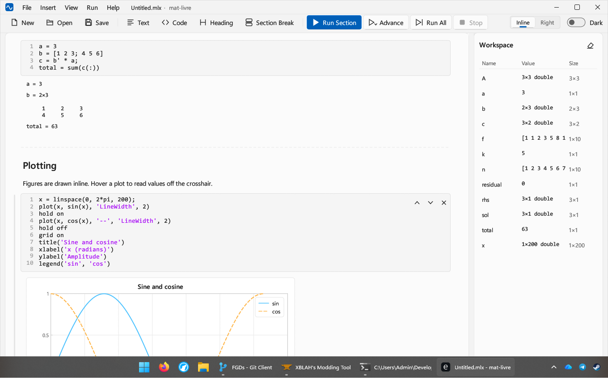

# matlivre

A clean-room, proof-of-concept live script environment for a MATLAB-compatible language,
written in Rust, with a Windows 11 look modeled on
[ModernWinForms](../../CS/ModernWinForms).



## Run

```bash
cargo run -p livre-app --release
```

Optionally pass a file: `cargo run -p livre-app --release -- path\to\script.mlx`.
Opens and saves `.mlx` (live script packages) and `.m` (plain scripts with `%%` sections).

| Shortcut | Action |
|---|---|
| Ctrl+Enter | Run current section |
| Ctrl+Shift+Enter | Run section and advance |
| F5 | Run all |
| Ctrl+Alt+Enter | Insert section break |
| Ctrl+N / Ctrl+O / Ctrl+S | New / Open / Save |

Clicking the gutter bar left of a section runs that section.

## Layout

| Crate | Purpose |
|---|---|
| `crates/livre-lang` | Lexer, parser, tree-walking interpreter, values, display formatting, ~200 builtins, figure model |
| `crates/livre-doc` | Live script document model; `.mlx` (OPC/ZIP + WordprocessingML) and `.m` reader/writer |
| `crates/livre-app` | eframe/egui desktop app: custom title bar, command bar, document editor, inline/right outputs, plots, workspace browser, light/dark skins |

Code runs on a dedicated engine thread that owns the base workspace and streams outputs back
to the UI (text, values, figures, warnings, errors), so the UI never blocks and **Stop** works
between statements.

## Clean-room process

[`docs/SPEC-live-script.md`](docs/SPEC-live-script.md) is the behavioral specification the
implementation was written from. It was produced by inspecting **data files and observable
behavior only** — the `.mlx` packages shipped with MATLAB R2023b (via REA artifact extraction)
and the public Live Editor behavior. No MathWorks source code was read or copied. Each spec
item is tagged as observed, inferred, or a design decision.

## Tests

```bash
cargo test --workspace
```

`livre-doc/tests/matlab_samples.rs` round-trips the live scripts shipped with a local MATLAB
install when one is present.

## Proof-of-concept limits

- Language: 2-D double/logical/char arrays, strings, cells, scalar structs, function handles.
  No complex numbers, integer types, N-D arrays, struct arrays, string arrays, classes, or
  `datetime`/tables.
- Live controls inside `.mlx` files load as plain code (their current value) and are not
  interactive; saved outputs in `output.xml` are not restored (re-run to regenerate) and are
  not written.
- Rich text formatting (bold/italic runs, links, equations, images) is flattened to plain text.
- Windows is the only tested platform; the stack (egui/winit/glow) is cross-platform.
